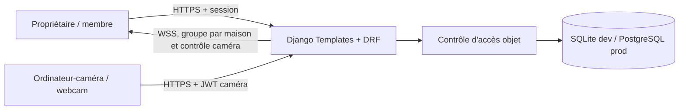
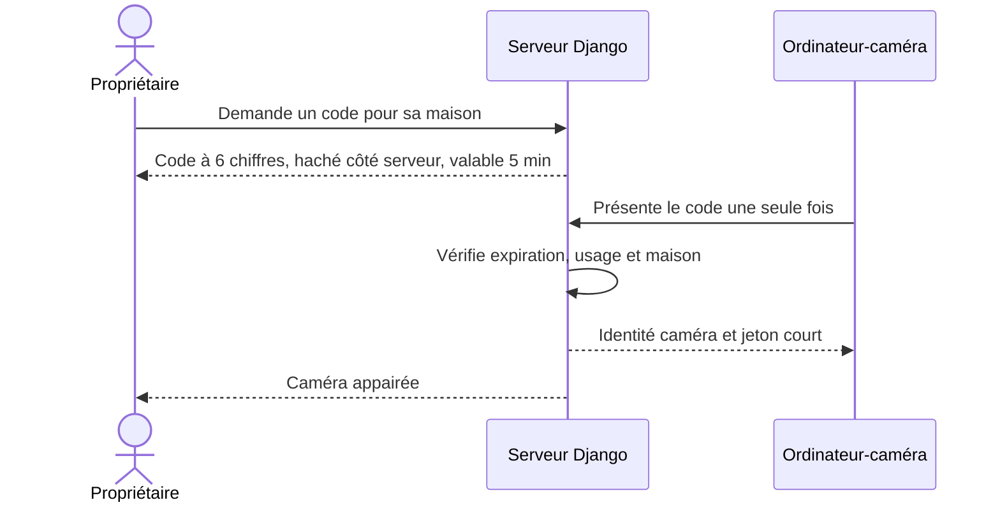
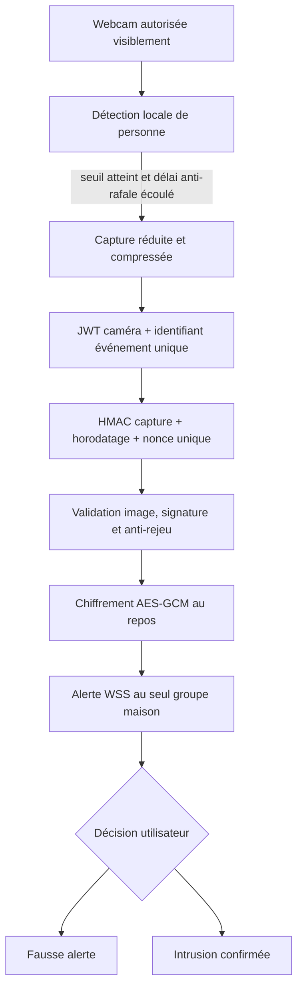
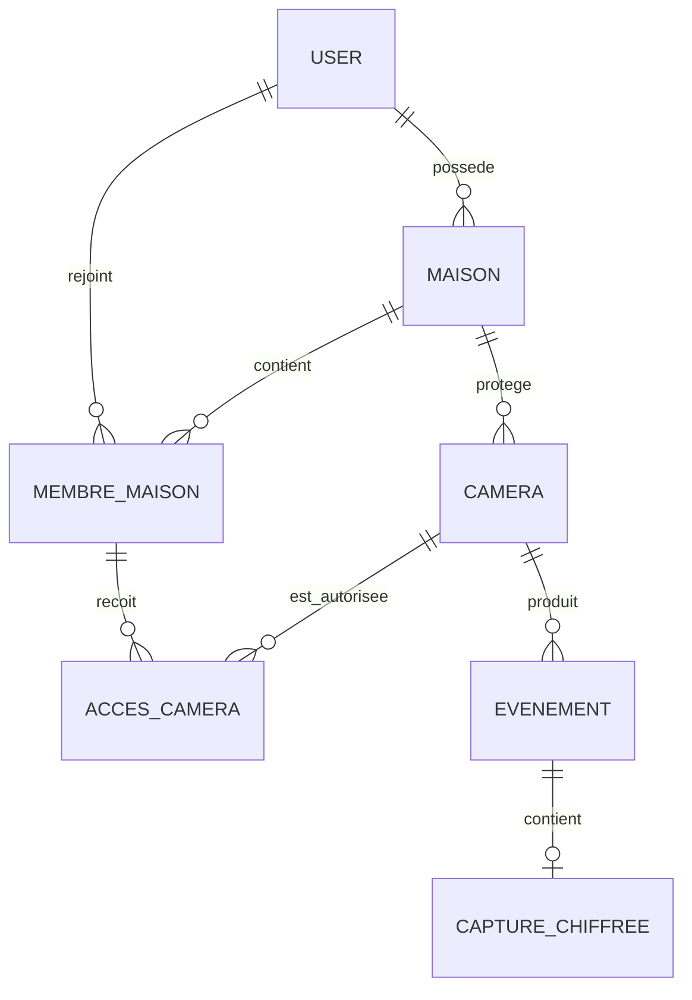

# Sentinelle Maison

Plateforme de surveillance intelligente pour les maisons : gestion des caméras, analyse des détections et alertes sécurisées. Le socle actuel utilise la webcam d’un ordinateur et une interface web. L’évolution produit prévoit les caméras IP, la surveillance planifiée, une application mobile, des alertes contextualisées, la reconnaissance des animaux et des visages, la détection de situations suspectes et l’authentification multifacteur.

> État au 27 septembre 2026 : **socle web opérationnel et pilote Android compilé**. L’application mobile attend sa recette sur téléphone réel ; la caméra RTSP attend toujours le matériel compatible.

## Organisation du produit

- [Feuille de route et périmètre des huit fonctionnalités](docs/produit/FEUILLE_DE_ROUTE.md)
- [Architecture cible et évolution du dépôt](docs/produit/ARCHITECTURE.md)
- [Backlog priorisé et critères de validation](docs/produit/BACKLOG.md)
- [Compatibilité et qualification des caméras réelles](docs/produit/CAMERAS.md)
- [Installation et recette de la passerelle RTSP](docs/produit/PASSERELLE_RTSP.md)
- [Plannings, exceptions et priorités manuelles](docs/produit/PLANNINGS.md)
- [État actuel et prochaine action](docs/produit/ETAT_ACTUEL.md)
- [Protocole de relais Codex ↔ Claude Code](docs/produit/RELAIS_AGENTS.md)
- [Contrat signé des événements caméra v2](docs/produit/CONTRAT_EVENEMENT_V2.md)
- [Réception idempotente et boîte d’envoi durable](docs/produit/BOITE_ENVOI_EVENEMENTS.md)
- [Rétention, sauvegarde chiffrée et rotation des clés](docs/produit/RETENTION_SAUVEGARDE_CLES.md)
- [Registre des modèles et décisions de distribution](docs/produit/REGISTRE_MODELES.md)
- [Application mobile Flutter et recette Android](docs/produit/APPLICATION_MOBILE.md)

Le premier lot porte sur la MFA, le contrat d’événement extensible et la fiabilité des traitements. Les rapports et présentations antérieurs restent des archives de la phase académique ; la documentation produit ci-dessus définit désormais la direction du projet.

## Contributeurs initiaux

- MUMBERE MITHIMBO DIEME
- LUANDA MURAIRI BERNARD
- BAZEBANZEA LIPEKENE ENOC
- MOMBIMBO N’SIESI XAVIER

## Fonctionnalités disponibles

- inscription, connexion et déconnexion avec sessions Django ;
- MFA TOTP facultative avec QR, secret chiffré, préauthentification courte, anti-rejeu et protection de l’administration ;
- mots de passe hachés avec Argon2id ;
- création et consultation de maisons ;
- rôles propriétaire, membre de la famille et invité ;
- ajout de caméras identifiées par UUID ;
- code d’appairage à six chiffres, valable cinq minutes et utilisable une seule fois ;
- code et secret durable de caméra stockés uniquement sous forme de HMAC-SHA256 ;
- identité d’appareil distincte et JWT caméra signé valable cinq minutes ;
- renouvellement du JWT avec le secret durable de l’appareil ;
- consultation d’état et signal de présence limités à la caméra authentifiée ;
- révocation immédiate de l’identité, des anciens JWT et du secret caméra ;
- activation explicite de la webcam avec arrêt immédiat ;
- planning par maison avec fuseau horaire, plages traversant minuit, exceptions prioritaires et dérogation manuelle expirante ;
- détection locale de la classe `person` avec YOLO11n 320 via ONNX Runtime Web, avec COCO-SSD/TensorFlow.js en secours ;
- bibliothèques d’inférence versionnées et servies localement pour garantir leur ordre et leur disponibilité ;
- déclenchement sur une image, seuil de confiance de 0,45 et délai anti-rafale de 15 secondes ; la validation temporelle renforcée fait partie du backlog produit ;
- capture redimensionnée et compressée, sans transmission continue du flux ;
- événements produits uniquement par l’analyse d’une caméra active ;
- validation Pillow du contenu, du MIME, des dimensions et de la taille ;
- chiffrement AES-GCM des captures avec nonce unique et données associées ;
- signature HMAC-SHA256 indépendante de chaque détection, couvrant la capture, l’identifiant d’événement, l’horodatage et un nonce à usage unique ;
- rejet des signatures invalides, requêtes trop anciennes et rejeux de nonce ;
- réception idempotente par `event_id` et empreinte du contenu signé ;
- boîte d’envoi transactionnelle avec reprise automatique et commande opérateur ;
- historique initial des événements et accès objet aux captures ;
- alerte visuelle immédiate par WebSocket sur toutes les pages authentifiées, avec reconnexion automatique ;
- sirène d’intrusion à deux tons activable explicitement par l’utilisateur, désactivée par défaut et interruptible immédiatement ;
- classement irréversible d’une alerte en fausse alerte ou intrusion confirmée ;
- diffusion par maison avec seconde vérification d’accès à la caméra avant chaque envoi ;
- Redis chiffré au niveau applicatif en production et canal mémoire limité au développement ;
- autorisations explicites des membres par caméra ;
- activation de la surveillance réservée au propriétaire ;
- isolation des maisons et caméras dans les vues HTML et l’API REST ;
- tableau de bord responsive ;
- pages 403, 404 et 500 sans détails internes ;
- limitation de débit des connexions, inscriptions, appairages, renouvellements de jeton et détections ;
- journal d’audit des actions sensibles avec adresse IP pseudonymisée et métadonnées sensibles expurgées ;
- politique CSP sans script en ligne et restrictions explicites des permissions navigateur ;
- endpoint de santé `GET /health/` ;
- application Flutter Android installable avec connexion MFA, renouvellement rotatif, reconnexion, déconnexion et stockage sécurisé des jetons.

## Architecture



Le projet est un monolithe Django ASGI : `accounts` gère l’utilisateur personnalisé et `homes` porte les maisons, adhésions, caméras, événements et permissions. L’évolution conserve ce serveur et ajoute progressivement des modules métier, une passerelle locale et un client mobile ; voir l’[architecture cible](docs/produit/ARCHITECTURE.md).

### Séquence d’appairage implémentée



### Flux de détection et d’alarme implémenté



### Relations principales



## Contrôles de sécurité déjà actifs

- CSRF sur tous les formulaires modifiant l’état ;
- cookies de session `HttpOnly`, `SameSite=Lax` et `Secure` en production ;
- redirection HTTPS configurable et prise en charge du proxy TLS ;
- en-têtes anti-sniffing, politique de référent stricte et refus d’intégration en iframe ;
- Argon2id en premier algorithme de hachage, PBKDF2 conservé uniquement pour migration ;
- requêtes `visible_to(user)` et formulaires dont les choix sont filtrés côté serveur ;
- UUID non séquentiels pour les caméras, sans les considérer comme un mécanisme d’autorisation ;
- codes à six chiffres hachés avec un pepper serveur séparé, expiration et revendication atomique ;
- secrets caméra aléatoires de forte entropie, conservés hachés côté serveur ;
- JWT HS256 avec émetteur, audience, sujet, expiration, identifiant unique et version révocable ;
- stockage des identifiants de l’ordinateur-caméra dans IndexedDB, jamais dans le `localStorage` humain ;
- validation puis normalisation JPEG des captures pour supprimer les métadonnées ;
- chiffrement authentifié AES-GCM avec clé de 256 bits, nonce aléatoire et identifiant d’événement associé ;
- refus d’un identifiant d’événement déjà utilisé ;
- HMAC-SHA256 indépendant du JWT sur une représentation canonique de la requête de détection ;
- fenêtre temporelle courte et nonce persistant à usage unique contre le rejeu ;
- déchiffrement à la demande uniquement après filtrage objet de l’événement ;
- WebSocket authentifié par la session Django et origine validée par `AllowedHostsOriginValidator` ;
- abonnement aux seuls groupes de maisons contenant une caméra visible, puis nouvelle autorisation objet avant chaque alerte ;
- décision d’alerte réservée au propriétaire ou à un membre ayant `peut_controler=True` ;
- couche Channels Redis obligatoire hors développement et messages Redis chiffrés avec une clé indépendante ;
- API REST limitée aux sessions authentifiées et filtrée avec les mêmes règles objet ;
- limitation de débit centralisable via Redis pour les opérations exposées aux essais automatisés ;
- journal d’audit immuable depuis l’administration, sans secret ni adresse IP brute ;
- CSP restrictive, `Permissions-Policy`, `Cross-Origin-Resource-Policy` et interdiction des objets et iframes ;
- variables d’environnement pour la configuration sensible.

WSS est prêt côté application et dépend du proxy TLS lors du déploiement. En production multi-processus, Redis est requis à la fois pour Channels et pour partager les compteurs de limitation de débit.

## Modèle de menace initial

| Menace | Contrôle actuel | Limite / suite |
|---|---|---|
| Utilisateur A modifie un UUID pour lire la caméra B | filtrage objet avant toute lecture HTML/API | tests automatisés actifs |
| Membre tente de contrôler une caméra en lecture seule | contrôle propriétaire sur l’action | permissions plus fines prévues |
| Soumission de formulaire intersite | jetons et middleware CSRF | HTTPS requis en production |
| Fuite de mot de passe après vol de base | Argon2id et MFA TOTP facultative | codes de récupération prévus dans SEC-002 |
| Fuite de secret Git | `.env` et données locales ignorés | gestionnaire de secrets de l’hébergeur requis |
| Vol/rejeu d’identité caméra | JWT court, version révocable, secret durable haché, HMAC d’événement, horodatage et nonce unique | protection du poste caméra et rotation des clés à formaliser |
| Lecture ou substitution d’une capture au repos | AES-GCM, nonce unique, données associées à l’événement et autorisation objet | rotation de clés à formaliser |
| Fuite d’une alerte vers une autre maison ou caméra | groupe WebSocket par maison, session authentifiée et vérification objet à chaque message | révocation de session centralisée à étudier |
| Coupure temporaire du réseau | reconnexion exponentielle du navigateur | Redis et supervision requis en production |

## API de l’ordinateur-caméra

- `POST /api/camera/appairer/` : échange un code temporaire contre l’identité initiale ;
- `POST /api/camera/token/` : renouvelle un JWT court avec l’identifiant et le secret appareil ;
- `GET /api/camera/me/etat/` : renvoie uniquement le nom, la maison et l’état de surveillance de la caméra authentifiée ;
- `POST /api/camera/me/presence/` : actualise sa dernière connexion.
- `POST /api/camera/me/detections/` : vérifie la signature HMAC et l’anti-rejeu, puis valide et chiffre une capture liée à une détection locale.

Les trois endpoints `me` exigent `Authorization: Bearer <jwt>`. La détection exige aussi `X-Camera-Timestamp`, `X-Camera-Nonce` et `X-Camera-Signature`. La clé HMAC indépendante est remise lors de l’appairage ou d’un renouvellement authentifié, puis conservée dans IndexedDB. Une caméra ne peut pas choisir un autre identifiant dans l’URL.

## Installation locale

Python 3.12 est la cible de référence. Django 5.2 LTS prend également en charge Python 3.14, utilisé lors de la validation locale initiale.

```powershell
python -m venv .venv
.\.venv\Scripts\Activate.ps1
python -m pip install -r requirements.txt
Copy-Item .env.example .env
python manage.py migrate
python manage.py runserver
```

Ouvrir ensuite `http://127.0.0.1:8000/`. La base SQLite locale convient uniquement au développement.

### Variables d’environnement

| Variable | Utilisation |
|---|---|
| `DJANGO_SECRET_KEY` | secret aléatoire obligatoire en production |
| `PAIRING_CODE_PEPPER` | secret indépendant pour hacher les codes temporaires |
| `CAMERA_CREDENTIAL_PEPPER` | secret indépendant pour hacher les secrets appareils |
| `CAMERA_JWT_SECRET` | clé HS256 indépendante d’au moins 32 octets |
| `CAMERA_TOKEN_TTL_SECONDS` | durée du JWT caméra, 300 secondes par défaut |
| `CAPTURE_ENCRYPTION_KEY` | clé AES-GCM de 32 octets encodée en base64 URL-safe |
| `BACKUP_ENCRYPTION_KEY` | clé AES-GCM indépendante protégeant les archives complètes |
| `CAMERA_SOURCE_ENCRYPTION_KEY` | clé AES-GCM indépendante protégeant URL et identifiants RTSP |
| `EVENT_SIGNING_ENCRYPTION_KEY` | clé AES-GCM indépendante protégeant les clés HMAC des caméras au repos |
| `MFA_ENCRYPTION_KEY` | clé AES-GCM indépendante protégeant les secrets TOTP |
| `MFA_PREAUTH_TTL_SECONDS` | durée maximale entre mot de passe et code TOTP, 300 secondes par défaut |
| `EMAIL_OTP_PEPPER` | secret indépendant utilisé pour condenser les codes MFA envoyés par e-mail |
| `EMAIL_OTP_TTL_SECONDS` | durée du code e-mail à usage unique, 600 secondes par défaut |
| `EMAIL_HOST`, `EMAIL_PORT`, `EMAIL_HOST_USER`, `EMAIL_HOST_PASSWORD` | serveur SMTP et identifiants d’envoi |
| `EMAIL_USE_TLS`, `DEFAULT_FROM_EMAIL` | chiffrement SMTP et adresse expéditrice |
| `RECOVERY_CODE_PEPPER` | secret indépendant utilisé pour hacher les codes de récupération |
| `CAMERA_EVENT_MAX_SKEW_SECONDS` | écart maximal accepté pour l’horodatage d’une détection, 60 secondes par défaut |
| `AUDIT_LOG_PEPPER` | secret indépendant pour pseudonymiser les adresses IP du journal d’audit |
| `MAX_CAPTURE_BYTES` | taille maximale d’une image avant validation, 2 Mio par défaut |
| `CAPTURE_RETENTION_DAYS`, `EVENT_RETENTION_DAYS` | conservation des captures et événements |
| `CAMERA_NONCE_RETENTION_HOURS`, `OUTBOX_RETENTION_DAYS`, `AUDIT_RETENTION_DAYS` | conservation des nonces, livraisons et audits |
| `DJANGO_DEBUG` | `False` en production |
| `DJANGO_ALLOWED_HOSTS` | hôtes séparés par des virgules |
| `DJANGO_CSRF_TRUSTED_ORIGINS` | origines HTTPS de confiance |
| `DATABASE_URL` | URL PostgreSQL en production |
| `REDIS_URL` | URL Redis obligatoire en production pour la couche Channels |
| `CHANNEL_ENCRYPTION_KEY` | clé indépendante d’au moins 32 octets pour chiffrer les messages transitant par Redis |
| `RATE_LIMIT_*` | seuils et fenêtres des limites de débit par opération sensible |
| `DJANGO_SECURE_SSL_REDIRECT` | force HTTPS |
| `DJANGO_SECURE_COOKIES` | cookies Secure |
| `DJANGO_SECURE_HSTS_SECONDS` | durée HSTS, `31536000` après validation HTTPS |

Le fichier `.env.example` ne contient que des valeurs fictives. `.env`, SQLite, médias, captures et fichiers statiques collectés sont exclus de Git.

Générer une vraie clé de chiffrement avant la production :

```powershell
python -c "import base64,secrets; print(base64.urlsafe_b64encode(secrets.token_bytes(32)).decode())"
```

Une modification de `CAPTURE_ENCRYPTION_KEY` rend les anciennes captures indéchiffrables. Une modification de `EVENT_SIGNING_ENCRYPTION_KEY` empêche de relire les clés HMAC déjà provisionnées. Une modification de `MFA_ENCRYPTION_KEY` invalide les facteurs TOTP existants. Leur rotation doit donc inclure une procédure de rechiffrement ou de réappairage contrôlé.

## Authentification multifacteur

Un utilisateur connecté active la MFA dans **Sécurité**, scanne le QR avec une application TOTP puis confirme un premier code. Dix codes de récupération sont affichés une seule fois ; seuls leurs condensats sont conservés et chaque code est consommé atomiquement. Après activation, le mot de passe crée uniquement une préauthentification de cinq minutes et déclenche l’envoi d’un code e-mail à six chiffres, valable dix minutes et utilisable une seule fois. La session Django finale est ouverte après un code e-mail, un TOTP ou un code de récupération valide. Le même parcours protège `/admin/`. Le remplacement du facteur exige le mot de passe et un second facteur, renouvelle les codes et révoque les autres sessions. Une action séparée permet aussi de révoquer toutes les autres sessions.

En développement, le backend e-mail par défaut écrit le message dans la console. Pour recevoir réellement le code, renseignez les variables SMTP de `.env.example`. En production, `EMAIL_HOST` et `DEFAULT_FROM_EMAIL` sont obligatoires.

## Migrations et tests

```powershell
python manage.py makemigrations
python manage.py migrate
python manage.py test --verbosity 2
python manage.py check --deploy
python manage.py dispatch_event_outbox --limit 100
```

La même base est exécutée automatiquement par GitHub Actions à chaque push et pull request avec Python 3.12 : contrôle des migrations manquantes, puis suite Django complète dans une base de test isolée.

Les tests existants couvrent notamment l’authentification, l’isolation objet et WebSocket entre maisons et caméras, l’appairage, les JWT, la révocation, le consentement webcam, l’ordre de chargement local du modèle IA, la validation d’image, AES-GCM, la signature HMAC, l’horodatage, l’anti-rejeu, la limitation de débit, le journal d’audit, CSP, la publication d’alerte et l’accès autorisé aux captures. Cette couverture ne constitue pas une validation terrain des modèles, des caméras IP ou de la livraison de notifications mobiles.

## Événements réels

Le mode simulation a été retiré. L’interface ne propose plus de bouton de démonstration et l’API refuse toute requête avec `simulated=true`. Les anciens événements simulés restent lisibles dans l’historique.

## Déploiement

Le projet est ASGI (`config.asgi:application`), compatible PostgreSQL via `DATABASE_URL`, servi avec Daphne, relié à Redis via `channels-redis` et préparé pour WhiteNoise. Sans `REDIS_URL`, un canal mémoire est utilisé uniquement en développement. Les fichiers `Procfile`, `build.sh`, `.python-version` et `render.yaml` fournissent une base de déploiement Render, avec PostgreSQL et un service Redis déclarés. `DEBUG=False`, TLS, les cookies sécurisés, Redis et de vraies clés indépendantes sont obligatoires. Le manifeste actuel ne provisionne ni passerelle caméra, ni ordonnanceur, ni worker de notification ; l’exploitation continue reste à préparer.

## Confidentialité et limites actuelles

- la webcam actuelle nécessite une activation explicite et un navigateur ouvert ; elle ne garantit pas une surveillance permanente ;
- le flux webcam est analysé localement ; seules les captures d’événements sont envoyées au serveur ;
- les alertes actuelles sont des alertes web et ne sont pas des notifications push natives ;
- le détecteur actuel reconnaît uniquement la classe `person`, sans identifier les personnes ;
- la reconnaissance faciale prévue sera facultative, limitée aux personnes inscrites volontairement dans une maison, avec suppression des profils et des données associées ;
- les détections d’objets et de comportements fourniront des indices à vérifier ; une correspondance de visage ne désarmera pas automatiquement la surveillance ;
- les durées de conservation, la suppression et la gestion des clés doivent être complétées pour l’exploitation ;
- le canal en mémoire convient au développement, pas à plusieurs processus de production.

## Dépendances externes et licences

- [Django 5.2 LTS](https://docs.djangoproject.com/en/5.2/) — BSD-3-Clause ;
- [Django REST Framework](https://www.django-rest-framework.org/) — BSD-3-Clause ;
- [Django Channels](https://channels.readthedocs.io/) et [Daphne](https://github.com/django/daphne) — BSD ;
- [channels-redis](https://github.com/django/channels_redis) — BSD-3-Clause ;
- [WhiteNoise](https://whitenoise.readthedocs.io/) — MIT ;
- [dj-database-url](https://github.com/jazzband/dj-database-url) — BSD-2-Clause ;
- [Psycopg](https://www.psycopg.org/psycopg3/) — LGPL-3.0 avec exceptions ;
- [python-dotenv](https://github.com/theskumar/python-dotenv) — BSD-3-Clause ;
- [argon2-cffi](https://argon2-cffi.readthedocs.io/) — MIT ;
- [PyJWT](https://pyjwt.readthedocs.io/) — MIT ;
- [Pillow](https://pillow.readthedocs.io/) — MIT-CMU ;
- [Cryptography](https://cryptography.io/) — Apache-2.0 ou BSD-3-Clause ;
- [OpenCV Python Headless](https://pypi.org/project/opencv-python-headless/) — Apache-2.0, installé séparément pour la passerelle RTSP ;
- [TensorFlow.js 4.22.0](https://www.npmjs.com/package/@tensorflow/tfjs) — Apache-2.0 ;
- [COCO-SSD 2.2.3](https://www.npmjs.com/package/@tensorflow-models/coco-ssd) — Apache-2.0 ;
- [ONNX Runtime Web](https://github.com/microsoft/onnxruntime) — MIT ; version locale documentée avec les assets ;
- YOLO11n exporté en ONNX — provenance, empreinte et licence AGPL-3.0 indiquées dans le [registre local du modèle](static/vendor/yolo/README.md).

Les dépendances serveur sont verrouillées dans `requirements.txt` et la passerelle vidéo dans `requirements-gateway.txt`. Le choix de distribution du produit et la compatibilité des licences du code, des poids IA et des données font partie du premier lot ; consulter les [conditions de l’éditeur YOLO](https://www.ultralytics.com/license).
