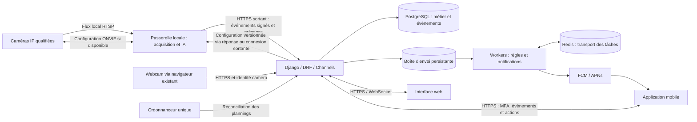

# Architecture cible de Sentinelle Maison

Statut : proposition d’implémentation du 22 septembre 2026. Les composants nouveaux décrits ici ne sont pas encore installés.

## Décision structurante

Conserver Django/DRF/Channels et ajouter une passerelle locale exécutée comme service. La passerelle acquiert les flux, analyse les images et applique les horaires sans dépendre d’un onglet ouvert. Le serveur conserve les utilisateurs, droits, configurations et événements ; le mobile utilise son API. Le navigateur webcam reste un mode d’acquisition existant.

La liaison caméra-passerelle reste sur le réseau de la maison. Les échanges avec le serveur sont initiés par la passerelle : aucun port RTSP domestique à publier sur Internet. La visualisation vidéo distante sera un canal média authentifié distinct, activé à la demande ; elle n’est pas nécessaire au premier parcours fondé sur les captures.

## Composants proposés

| Composant | Choix de travail | Motif et limite |
|---|---|---|
| Serveur métier | Django, DRF, Channels existants | Réutiliser les autorisations et l’historique ; extraire les responsabilités progressivement |
| Base | PostgreSQL en exploitation | Source durable des événements, configurations, traitements et livraisons |
| Traitements différés | Celery + Redis, à introduire | Découpler réception et notification ; les lignes persistantes restent la référence pour les reprises |
| Planification | Un ordonnanceur actif + réconciliation idempotente | Éviter les transitions en double ; diffuser des plannings versionnés à la passerelle |
| Passerelle | Service Python ; acquisition FFmpeg ; interface de modèle indépendante | Démarrage au boot, accès réseau local, limites de ressources par caméra |
| Mobile | Flutter proposé, Android en premier par hypothèse | Préparer Android et iOS depuis un code partagé ; décision à confirmer selon l’équipe |
| Push | FCM pour Android ; intégration APNs pour iOS via FCM si retenue | Tester permissions, économie d’énergie, arrière-plan et fermeture forcée |
| Captures | AES-GCM existant ; stockage objet chiffré à prévoir si le volume le justifie | Conserver l’autorisation objet avant lecture et une suppression cohérente |

Flutter fournit une architecture multiplateforme ; c’est un choix proposé pour ce produit, pas une dépendance actuelle. [Documentation Flutter](https://docs.flutter.dev/resources/architectural-overview).

Celery précise qu’un même planning doit avoir un seul ordonnanceur et que les tâches peuvent se chevaucher : prévoir verrouillage et idempotence. [Tâches périodiques Celery](https://docs.celeryq.dev/en/stable/userguide/periodic-tasks.html).

## Organisation du dépôt

La racine Django reste en place pour préserver les commandes, imports, migrations et scripts de déploiement. Les dossiers futurs seront créés lorsqu’ils contiendront un composant fonctionnel.

| Emplacement | État | Responsabilité |
|---|---|---|
| `accounts/` | Existant, à étendre | Comptes, MFA, récupération et sessions utilisateur |
| `homes/` | Existant, à conserver | Maisons, permissions, caméras et événements déjà stockés |
| `config/` | Existant, à étendre | Paramètres, ASGI, routage et démarrage des workers |
| `surveillance/` | À créer en L2 | Plannings, zones, modes et état appliqué |
| `vision/` | À créer en L3 | Contrats de détecteurs, registre des modèles et résultats normalisés |
| `notifications/` | À créer en L1/L4 | Boîte d’envoi, canaux, préférences, installations mobiles et livraisons |
| `biometrics/` | À créer en L5 | Profils volontaires, consentements, descripteurs chiffrés et suppression |
| `edge/` | À créer en L2 | Service local, acquisition RTSP, cache de configuration et tampon d’événements |
| `mobile/` | À créer en L4 | Application Flutter si le choix est retenu |
| `docs/produit/` | Présent | Périmètre, architecture, backlog et qualification des caméras |

Les modèles `Camera` et `Evenement` restent initialement dans `homes` pour éviter une migration destructive. Extraire d’abord les services métier ; déplacer éventuellement les modèles dans un chantier dédié avec migration et vérification de l’historique. Aucun nouveau dossier ne constitue à lui seul une fonctionnalité livrée.

## Contrat d’événement et compatibilité

Le client v2 envoie l’instant d’observation, le modèle, sa version, les objets détectés et une capture. Le champ signé `simulated` est conservé pour la compatibilité mais doit valoir `false` ; le serveur refuse toute simulation.

Le contrat v2 distingue :

- l’observation brute : identifiant unique, caméra, instant observé, objets/classes, boîtes normalisées, scores et identifiants de suivi locaux ;
- la provenance : modèle, version, empreinte, passerelle et version de configuration ;
- la décision métier : règle déclenchée, zone, priorité, explication et version de règle ;
- le transport : instant de soumission, instant de réception et indicateur de synchronisation différée.

La priorité est calculée depuis la politique de la maison, jamais acceptée comme une autorité fournie par un client. Limiter les tailles, le nombre d’objets et les champs autorisés. Les identifiants de suivi servent à regrouper les images d’une même scène ; ils ne sont pas des identités biométriques.

La réception est idempotente par identifiant et empreinte du contenu signé. L’événement et sa ligne de boîte d’envoi sont écrits dans la même transaction. La livraison temps réel est au moins une fois : le navigateur déduplique les messages avec l’identifiant serveur et les présences caméra reprennent les lignes en attente.

Versionner explicitement le message signé. La signature v2 doit couvrir l’intégralité du manifeste canonique et l’empreinte de la capture, y compris classes, horaires, zones et provenance ; aucun nouveau champ influençant une alerte ne doit rester hors signature. Publier des vecteurs de test communs JavaScript/Python. Une nouvelle route v2 coexiste avec la v1, dont les anciens clients gardent le fonctionnement documenté.

La création de l’événement et celle de sa ligne de boîte d’envoi sont atomiques. Un identifiant d’observation retransmis ne crée ni nouvel événement ni nouvelle alerte. Une contrainte d’unicité protège les livraisons par événement, destinataire et canal. La reprise du worker peut renvoyer une notification si le fournisseur a accepté un envoi avant une panne locale ; le mobile regroupe aussi par identifiant d’événement. On vise des reprises idempotentes, sans promettre une livraison réseau exactement une fois.

## Coupures et planification

La passerelle conserve un planning versionné, son fuseau IANA et un tampon d’événements chiffré avec une limite de durée et de volume. Elle poursuit le dernier planning validé hors ligne ; les changements distants en attente sont affichés comme non appliqués. Après redémarrage, elle recalcule immédiatement l’état attendu. Une perte de courant empêchant la passerelle de tourner doit apparaître comme une interruption, pas comme une maison protégée.

L’utilisateur voit séparément « surveillance demandée », « surveillance appliquée » et « analyse disponible ». La présence réseau seule ne prouve pas que les images sont analysées.

Les règles comprennent des plages hebdomadaires, jours exclus, passages de minuit, fuseau de chaque maison et dérogation manuelle avec expiration. Une dérogation manuelle active prime sur le planning ; à expiration, l’état courant du planning reprend. Le serveur est la référence de configuration, la passerelle confirme la version appliquée. Chaque transition possède une clé idempotente ; une concurrence entre worker et action manuelle ne doit pas réactiver une surveillance désarmée temporairement.

L’API actuelle refuse les signatures de plus de 60 secondes et utilise l’heure de réception comme heure d’événement. Il faut donc concevoir le mode différé en v2 : conserver `observed_at`, signer la soumission avec une heure et un nonce frais, contrôler l’âge maximal autorisé, conserver la déduplication et vérifier le planning applicable à l’observation. Une caméra ou passerelle révoquée est refusée même pour des événements tamponnés. Les événements trop anciens peuvent rejoindre l’historique selon la rétention, sans générer une rafale d’alertes urgentes au rétablissement.

## Vision et règles d’alerte

Chaîne cible : acquisition → objets → suivi temporel → règles de zone/horaire → événement → priorité → notification. La personne reste suivie même si un animal apparaît dans la même image. Le nombre d’images de confirmation, les durées et seuils sont configurés et évalués ; ils ne sont pas fixés uniquement pour donner l’impression d’une réponse instantanée.

Le modèle COCO utilisé comme base inclut chiens et chats ainsi qu’une classe couteau, mais sa liste de classes ne comprend pas les armes à feu. La détection d’un couteau ne suffit pas à déduire une menace. Un détecteur spécialisé et un protocole d’évaluation distinct sont donc prévus pour la suspicion d’arme. [Classes COCO documentées par Ultralytics](https://docs.ultralytics.com/datasets/detect/coco/).

La reconnaissance faciale est un module facultatif de comparaison avec une galerie limitée à la maison. Les descripteurs sont chiffrés avec une gestion des clés distincte ; ni eux ni les photos d’inscription ne transitent dans les push. Prévoir qualité minimale, refus de correspondance incertaine, retrait du consentement et purge des copies de passerelle. Un retrait prend effet immédiatement côté serveur ; une passerelle déconnectée ne peut le recevoir qu’à sa reconnexion. Son cache biométrique doit donc avoir une autorisation à durée courte, au-delà de laquelle les comparaisons cessent jusqu’à renouvellement ; la surveillance non biométrique continue. Un visage connu ne désarme pas le système et n’annule pas une alerte d’arme ou de franchissement de zone.

## Authentification et mobile

La MFA est d’abord un parcours web complet : préauthentification de courte durée après le mot de passe, validation du TOTP puis ouverture de la session finale. Les protections couvrent également l’administration, l’inscription et les voies de récupération pour éviter un contournement. Codes de récupération à usage unique stockés sous forme de condensat, secret TOTP chiffré et anti-rejeu du code accepté. Revalidation d’un facteur pour le remplacer ou le désactiver. [Recommandations MFA OWASP](https://cheatsheetseries.owasp.org/cheatsheets/Multifactor_Authentication_Cheat_Sheet.html).

Pour le mobile, ajouter un contrat `/api/v1/` utilisateur : connexion, challenge MFA, sessions, maisons, caméras, événements, captures, décisions et préférences. Ce chemin est une cible, pas une API existante. Les jetons utilisateur ont une audience distincte de celle des caméras ; un jeton caméra ne peut jamais ouvrir un compte humain. Utiliser un mécanisme maintenu, des accès courts, des renouvellements rotatifs et une révocation par appareil. Sur téléphone, les secrets sont placés dans le stockage sécurisé du système. Les sessions web gardent leurs protections CSRF.

Les push contiennent un identifiant d’événement et un texte minimal selon les préférences de confidentialité. L’app recharge le détail depuis l’API et revérifie les droits ; le lien reçu n’accorde aucun accès. Supprimer les jetons push invalides et dissocier l’installation à la déconnexion. Revérifier les destinataires avant envoi ; une notification en transit peut subsister après révocation, mais son ouverture doit être refusée.

Suivre séparément attente, envoi accepté par le fournisseur, échec et lecture dans l’app. Les permissions du système et certains arrêts forcés peuvent empêcher la réception ; prévoir un rattrapage d’historique. [Réception de messages FCM dans Flutter](https://firebase.google.com/docs/cloud-messaging/flutter/receive-messages).

## Exploitation

Prévoir des services distincts pour ASGI, worker, ordonnanceur et passerelle. `/health/` retourne actuellement un simple statut : ajouter une vérification de disponibilité des dépendances et du retard de traitement. Mesurer la fraîcheur des images, le temps d’analyse, les événements rejetés, la file en retard et les erreurs push.

La rétention porte sur captures, événements, audit, nonces, profils faciaux et tampon local. Documenter rotation des clés, restauration, purge et expiration des sauvegardes. La désactivation d’un module IA ne doit pas bloquer l’acquisition ou les autres détections. Les migrations sont additives avec possibilité de retour applicatif ; toute reprise de données est testée avant utilisation sur une base existante.
